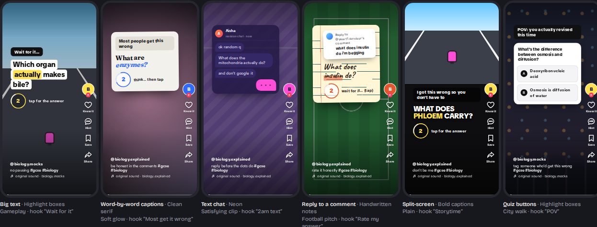
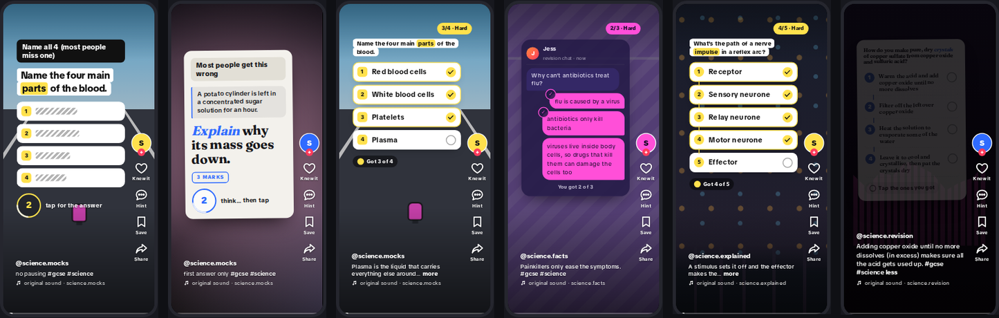
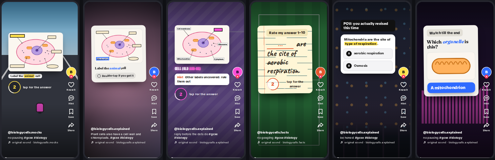

# Reelcards

**Revise without trying.** Reelcards slips your flashcards in between your TikTok, Instagram Reels and YouTube Shorts, styled so they look like just another reel. Double-tap if you know it, swipe if you don't. An adaptive engine decides *when* a card appears, *which* card it is and *how it looks*, and it learns what each student actually watches.

- Android 8.0+ · one permission · works offline · no account · no ads · ~410 KB app, no third-party libraries
- Ready-made GCSE decks, pasted notes (or cards a chatbot makes from them, with our prompt), your **Anki decks** (answers go straight back into AnkiDroid), or any **Anki file** (.apkg or .colpkg), cloze and image occlusion cards included
- Open source (GPLv3)







<sub>Card designs from the [design lab](web-demo/index.html): the same card in six layouts, each over a different looping background, then cards imported from an Anki file. Instagram and YouTube versions are in [docs/DESIGN.md](docs/DESIGN.md).</sub>

---

## Install it on a phone (students)

1. Download **[`Reelcards.apk`](release/Reelcards.apk)** onto the Android phone (from the Releases page, this repo, or a USB cable).
2. Open it. If Android asks, allow your browser or Files app to **install unknown apps**, then tap **Install**.
3. Open **Reelcards** and follow the 4 short steps:
   1. **Pick what you're revising:** a ready-made deck, paste your notes (*Copy the AI prompt* gets a chatbot you already use to turn them into cards), your Anki decks, or open an Anki file (.apkg).
   2. **Exam date, what you watch, how often:** pick your exam date, your interests (football, gaming, music…) and Chill (1 card every 8 reels), Normal (every 5) or Cram (every 3).
   3. **Switch it on:** tap *Open settings* → *Reelcards* → turn it on → *Allow*. It's the only permission.
   4. **Try it:** tap *Show me a test card*, then open TikTok, Instagram or YouTube Shorts and scroll.

**Switch greyed out?** Android 13+ blocks accessibility for apps installed from a file. In Reelcards tap *Open app info* → **⋮** (top right) → **Allow restricted settings** → confirm, then turn the switch on. Installing from a computer with `adb install` avoids this.

**No Android phone?** Open [`web-demo/index.html`](web-demo/index.html) in any browser (or turn on GitHub Pages; the workflow is included). It runs the same engine, ported to JavaScript, through the whole setup → feed → dashboard journey, with the engine's reasoning shown alongside and a design lab of every card style.

**On a computer:** the browser extension in [`extension/`](extension/) puts your cards between videos on TikTok, Instagram Reels, YouTube Shorts and X in Chrome or Edge ([how to install it](extension/README.md)).

**On an iPhone (or any phone):** open the web demo from GitHub Pages and add it to the home screen (Safari: Share → *Add to Home Screen*; Chrome on Android offers an *Add to home screen* button on the page). It then opens full screen as just the phone part, with no demo panels, and works without signal. It can't put cards between real TikTok reels (only the Android app can), and it keeps your cards and progress in the browser on that device (nothing is sent anywhere; *Reset everything* clears it).

**No permission? No problem.** The **Practice feed** inside the app is a pretend reel feed that uses the exact same engine, cards and designs. Good for demos with no Wi-Fi and no TikTok.

---

## On a card

| Do this | It means | Grade (Anki ease) |
|---|---|---|
| Double-tap or ♥ **before** the answer shows, quickly | I knew it | Easy (4) |
| Double-tap before the answer, but slowly | I knew it, with effort | Good (3) |
| Tap to reveal, then double-tap | I knew it | Good (3) |
| Quiz: right option, quickly / slowly | | Good (3) / Hard (2) |
| 💬 **Hint** (first letter and length), then knew it | Knew it with help | Hard (2) |
| Reveal with no like, or the wrong quiz option | Didn't know it | Again (1) |
| Swipe past without looking | Not now | not graded, comes back 3 reels later in a different look |
| 🔖 **Save** | Bring this back soon | due within a day |
| ➦ **Share** | Send the question to a friend | not graded, not a skip; the card waits while you share |

"Quickly" is measured against how long the question takes to read, following response-time-based scheduling research ([details](docs/ENGINE.md#grading)).

---

## 2-minute hackathon demo

| Time | Do this | Say this |
|---|---|---|
| 0:00 | Open Reelcards and play the sample card on the welcome screen: tap it, then double-tap. | "Students scroll 3–4 hours a day. We turn that time into revision without asking them to stop." |
| 0:20 | Dashboard → **How often: Demo** (1 card every 2 reels). Open **Practice feed** and swipe. Tap the style button at the top to switch between TikTok, Instagram and YouTube. | "Every few reels a flashcard slides in, styled like the app you're in: its buttons, its caption layout, its font." |
| 0:45 | On a card tap **Why?** | "The engine decided *when* (a rhythm it learns from you, waiting for natural breaks), *which* (lowest predicted recall, using FSRS, the algorithm in Anki) and *how it looks* (it learns your favourite formats, per app)." |
| 1:05 | Swipe a card away without looking; it comes back 3 reels later in a different look. | "Skipping never punishes you. It just tries a different format later." |
| 1:20 | Open real TikTok or Instagram and scroll (the switch must be on). | "This is running over the real app." |
| 1:40 | Dashboard: cards today, recall, forecast, what the engine learned, saved cards, Anki sync. | "In our 30-day simulation, adaptive formats and rhythm cut skipped cards from 66% to 51% and raised modelled exam-day recall from 17% to 27%." |

Tip: set **How often** back to **Normal** afterwards.

---

## How it works

```
 TikTok / Instagram / YouTube        Reelcards (same phone, offline)
 ┌──────────────────────┐     scroll events     ┌─────────────────────────────────────────┐
 │  you swipe a reel    │ ───────────────────▶  │ ReelWatcherService (accessibility)      │
 └──────────────────────┘                       │   ReelDetector: was that a new reel?    │
            ▲                                   │ Engine                                  │
            │  card drawn on top                │   1 WHEN   learned rhythm, natural      │
            │  (accessibility overlay)          │            breaks, warm-up, cap, exam   │
            └────────────────────────────────── │   2 WHICH  skipped → learning → lowest  │
                                                │            recall (FSRS-6) → new        │
                                                │   3 LOOK   hook × layout × look × bg,   │
                                                │            recovering contextual bandit │
                                                │ CardView   host-app styling, gestures   │
                                                │ Grades → FSRS-6 schedule, or AnkiDroid  │
                                                └─────────────────────────────────────────┘
```

- **When:** no cards in the first 3 reels of a session. After that, cards come at a rhythm the engine learns per student (Thompson sampling over six spacings, maximising *answered cards per reel scrolled*). It holds a card back after a reel you watched for 25 s+, brings it forward when you're skimming, and pauses for 15 minutes after 5 fast skips in a row. There's a daily cap and a one-tap pause.
- **Which:** cards you skipped come back first, then short learning steps, then due reviews with the lowest predicted recall (recall *on exam day* when it's close), mixing subjects. New cards are paced so the whole deck is seen before the exam.
- **How it looks:** 6 hooks × 7 layouts × 5 looks × 7 backgrounds = 1,470 combinations. A bandit learns which pieces each student engages with, separately per app, with a fading penalty on recently used pieces so looks keep rotating (after Duolingo's notification bandit).
- **Long answers:** the engine reads each card's shape first. A 3-mark answer is split into points that drop in one at a time, the student taps the points they got (all = Good, half = Hard, fewer = Again), long explanations go behind "more" in the caption, and a long question's set-up goes in a small quoted box. Quiz buttons are kept for short answers. Works on Anki cards too (`<br>` and lists become points).
- **Memory model:** FSRS-6 (identical to the reference `py-fsrs` on every checked step), exam-aware (target recall 90% → 92% three weeks out → 95% in the final week; no interval past the exam). After 100 long-term reviews it fits a personal forgetting rate.
- **Anki:** uses AnkiDroid's official content provider API. It reads the cards Anki has scheduled for the chosen decks, with each card's note and note type, so they follow the same rules as an Anki file (a cloze gap is a blank, and the answer is just the deletion). It writes each reel answer back as a normal review, unless the card was answered in AnkiDroid meanwhile. Anki stays in charge of those cards, and AnkiDroid's own sync carries them to AnkiWeb and desktop. AnkiDroid doesn't share pictures with other apps, so cards whose question needs a picture stay in AnkiDroid, and the dashboard suggests exporting that deck as a .apkg.
- **Anki files (.apkg), no AnkiDroid needed:** opens decks exported from any Anki version (2.0, 2.1, and the newer compressed format), including shared decks from AnkiWeb, with no account and no internet. Basic, reversed, type-in and custom note types work; **cloze** cards become one card per gap number, the gap drawn as a blank (a gap number used three times = a 3-point answer); **image occlusion** cards (Anki's built-in type and the older add-on) show the picture with the part to name masked in the card's accent colour: tap to uncover it, double-tap if you knew it, and the hint uncovers the other labels so you can rule them out. Pictures on normal cards are shown too, and sounds play (a question that's only a sound asks "Listen: what's this?"). Review cards keep their Anki progress. It's a one-way import: answers stay in Reelcards. Suspended cards, and cards with nothing to read on either side, are left out.
- **Notes → cards (no AI needed):** understands `term - definition`, `term: definition`, `Q:/A:` pairs, tab-separated exports from Anki or Quizlet, and simple sentences like "Enzymes are biological catalysts." (→ "What are enzymes?").

Full write-up, with the research behind each choice: **[docs/ENGINE.md](docs/ENGINE.md)**.

## How it's designed to fit in

A card has to pass as a reel at a glance, in whichever app it appears and whatever that student watches:

- **The host app's own frame.** Each app keeps its buttons and captions in different places, so cards follow that app's safe zones, its right-hand rail (♥ on TikTok and Instagram, 👍 on YouTube; a paper plane for sharing on Instagram), its caption band (account, caption, hashtags, sound line) and its typeface (TikTok Sans on TikTok, Roboto on YouTube, the system font on Instagram).
- **Creator formats.** Big captions with the key word highlighted, word-by-word auto-captions, a group-chat screenshot, "replying to a comment", split-screen over gameplay, a poll sticker, and notes pages that look like a creator's screenshot.
- **Themed to the student.** Pick interests at setup and cards pick up a matching touch: a broadcast scorebug for football fans, a game HUD and "+25 XP" for gamers, a visualiser for music. The format engine starts from matching tastes, then learns.
- **Time and colour.** After 10pm the light styles switch to dark versions. With the opt-in **Match my feed's colours** (Android 11+), dark styles are tinted to the reel you just watched. It uses one screenshot, reduced to a single colour on the phone and then deleted.

More, including screenshots for each app: **[docs/DESIGN.md](docs/DESIGN.md)**.

---

## Proof it works

**Engine checks:** 128 plain-Java checks, including FSRS-6 against `py-fsrs`, gesture and response-time grading, rhythm learning, skipping, quiet mode, format learning, calibration, notes parsing (and chatbot replies), long answers and part marks, reading all three Anki file formats (cloze, image occlusion, pictures, kept progress), decks exported by Anki itself compared card by card with how Anki shows them, a dense USMLE Step 1-style deck (vignettes, tables, long cloze notes), AnkiDroid notes, forecasting, and the hint, save and share buttons. Output: [`engine/results/checks.txt`](engine/results/checks.txt).

**30-day simulation:** 30 simulated students per row, a 600-card deck (70 real GCSE cards and 530 synthetic ones), with the exam on day 30. This is a *model*, not user data. Each simulated student has a hidden memory, a taste for some card looks, and a tolerance for how often cards appear. Output: [`engine/results/simulation.txt`](engine/results/simulation.txt).

| Engine version | Cards skipped | Cards engaged with per day | Modelled exam-day recall |
|---|---|---|---|
| Baseline: random looks, fixed rhythm | 66% | 24 | 17% |
| + adaptive looks | 57% | 35 | 25% |
| Full: + learned rhythm and natural breaks | **51%** | **38** | **27%** |

These are averages over four student types at 1 hour and 3.5 hours of reels a day. For a heavy scroller (3.5 h a day) with a taste in formats, the full engine gets 58–68 cards engaged with per day and 43–47% modelled exam-day recall on the whole 600-card deck. For a student with no format preference, adaptive looks make almost no difference, as expected.

Run them yourself:

```
./gradlew :engine:engineChecks          # 128 passed, 0 failed
./gradlew :engine:simulate              # about 2 minutes
```

No Gradle? Use `javac -d out $(find engine/src -name '*.java') && java -cp out EngineChecks`.

---

## Build it yourself

- **Android Studio:** *Open* this folder → wait for Gradle sync → press ▶ with a phone plugged in (USB debugging on).
- **Command line:** `./gradlew assembleDebug` → `app/build/outputs/apk/debug/app-debug.apk`.
- **GitHub Actions:** every push runs the engine checks and builds the APK (download it from the run's **Artifacts**). Pushing a tag like `v1.0.0` publishes a Release with the APK attached. [`pages.yml`](.github/workflows/pages.yml) publishes the web demo to GitHub Pages.
- **Without Gradle:** `tools/build-apk.sh` builds the APK straight from `aapt2`, `javac`, a dexer and `apksigner`. That's how the APK in `release/` was made.
- **Web demo:** edit `web-demo/src/`, then `python3 tools/build-web-demo.py` rebuilds the single-file `web-demo/index.html`. `python3 tools/lab-shots.py` screenshots the design lab.
- **Keeping the two engines in step:** `tools/crosscheck/run.sh` checks the Java engine against the web demo's JavaScript port (CI runs it too).

Debug builds are signed with the shared debug key in `tools/`, so any teammate's build can update the same installed app. **Use your own private key for anything you publish:** `tools/make-upload-key.sh` makes one, and release builds use it when it's set up (see [docs/PLAY-STORE.md](docs/PLAY-STORE.md)).

---

## Tuning reel detection on real phones

TikTok, Instagram and YouTube rename their internal views from time to time. Dashboard → **Reel detection log** shows every scroll the watcher saw, whether it counted as a reel swipe, and the view names. If an app stops being detected, add the new view name to `REEL_IDS` in [`ReelDetector.java`](app/src/main/java/com/reelcards/app/ReelDetector.java).

Current rules: any full-screen vertical pager in TikTok. In Instagram, YouTube, Snapchat, Facebook, X, Reddit and Pinterest, the known reel viewers (`clips_viewer…`, `reel_…`, `shorts`, `spotlight`) or any full-screen vertical feed whose top item changes.

---

## Project layout

```
engine/                       the engine: plain Java 8, no Android, no dependencies
  src/main/java/…/engine/
    Engine.java               WHEN / WHICH / LOOK, grading, skipping, quiet mode, saved cards
    Fsrs.java                 FSRS-6 scheduler, exam-aware
    Rhythm.java               learns how often each student wants cards
    FormatBandit.java         learns which looks each student engages with, per app
    Calibration.java          fits a personal forgetting rate
    Grade.java                gestures + timing → Again / Hard / Good / Easy
    CopyWriter.java           the words for each hook, hint and caption (the plug-in point for AI)
    Format.java               hooks, layouts, looks, backgrounds, interest themes
    NotesParser.java          pasted notes → cards
    Stats.java                daily stats + forecast
    AnswerShape.java          long answers → points, long questions → set-up + question
    Occlusion.java            image occlusion masks, as fractions of the picture
    SampleDecks.java          GCSE Biology, Chemistry, Spanish, Science (longer answers)
    anki/                     Anki files with no libraries: AnkiPackage (.apkg → cards),
                              SqliteFile, Zstd, Json readers
  src/test/java/              EngineChecks + Simulate
  src/test/resources/anki/    test decks in all three Anki formats (made by tools/make-test-decks.py);
                              real/: decks exported by Anki itself (tools/real-anki-decks.py)
  results/                    saved outputs of both
app/src/main/java/com/reelcards/app/   the Android app
  MainActivity.java           setup wizard + dashboard
  ReelWatcherService.java     the accessibility service + overlay
  ReelDetector.java           "was that a new reel?"
  CardView.java               a flashcard drawn as a reel in the host app's style
  ReelBackground.java         looping backgrounds, drawn in code
  Icons.java, Fonts.java      rail icons (SVG paths) and bundled fonts
  FeedColour.java             opt-in "match my feed's colours"
  PracticeFeedActivity.java   pretend feed for demos
  AnkiBridge.java             AnkiDroid read + write
  Store.java                  saves everything to one JSON file on the phone
app/src/main/assets/fonts/    TikTok Sans, Anton, Caveat, Fraunces (SIL OFL, licences included)
web-demo/                     browser version of the whole journey (src/ + built index.html)
docs/                         ENGINE.md, DESIGN.md, ROADMAP.md, PLAY-STORE.md, PHONE-TESTS.md,
                              design critique, screenshots, play-store/ (listing graphics)
tools/                        Gradle-free APK build, web-demo and privacy-page builds, test-deck
                              makers (by hand and with Anki's own library), Java/JS cross-check,
                              design-lab and store screenshots, upload-key scripts, shared debug key
CLAUDE.md                     project rules and commands for Claude Code (and anyone new)
```

---

## Privacy

The accessibility service listens only for *scroll* and *window-change* events, to notice a new reel. It never reads your messages, never records what you watch, and nothing is sent anywhere. Everything is stored in one file on the phone, plus the pictures from any Anki file you open, in the app's private storage. The optional colour-matching setting is off by default; when on, it reduces one screenshot per reel to a single colour in memory and throws the image away. Details: [PRIVACY.md](PRIVACY.md).

## Licence and money

Reelcards is free software under the [GNU GPL v3](LICENSE). The code stays open, and anyone who ships a modified version has to share their changes too. The plan is a free app with an optional one-time unlock on the Play Store. The GPL allows charging for builds, but anyone may also build and share it for free. The fonts in `app/src/main/assets/fonts/` are under the SIL Open Font License (licence files alongside).

## Honest limits (and what's next)

- **Not yet tested on a physical phone.** The APK builds in CI, the engine is tested, and the Android code runs under Robolectric on Android 14 and 16, but it hasn't run on a device or emulator. [docs/PHONE-TESTS.md](docs/PHONE-TESTS.md) is the checklist for 2–3 real phones.
- **Anki files:** a one-way import. Sounds play, but cards that are only sounds (nothing to read) and Anki's text-to-speech fields are left out. The reader is checked against decks Anki itself exported (`tools/real-anki-decks.py`: the default format, "support older Anki versions" and a collection package), compared card by card with how Anki shows them, and against decks written to each file format by `tools/make-test-decks.py`. Shared decks from AnkiWeb and the old Image Occlusion Enhanced add-on haven't been tried as real files yet, so please send any deck that doesn't open.
- **Android only.** iPhones don't let apps detect individual reels; an iOS version would use Screen Time to trigger a card every few minutes instead.
- **Play Store:** the app targets API 36, shows Google's prominent disclosure before the accessibility settings, signs release bundles with your own upload key, and has a privacy policy page and listing graphics. What's left needs a Play Console account: [docs/PLAY-STORE.md](docs/PLAY-STORE.md). Google reviews non-accessibility uses of the AccessibilityService API closely, so approval isn't guaranteed.
- **Backgrounds** are drawn in code as stand-ins for looping footage, to keep the app tiny and offline.
- **Copy is templated.** *Make cards with AI* uses a chatbot the student already has, outside the app. On-device AI (Gemini Nano via ML Kit's GenAI APIs) would need Google's ML Kit library, which the no-third-party-libraries rule doesn't allow yet; `CopyWriter` is the plug-in point.
- **The simulation is a model.** Real numbers need a pilot with real students: *Share my numbers* on the dashboard and [docs/PILOT.md](docs/PILOT.md) are ready for one.

What's next, in order: [docs/ROADMAP.md](docs/ROADMAP.md). See [CHANGELOG.md](CHANGELOG.md) for what changed, and [CONTRIBUTING.md](CONTRIBUTING.md) to help.
