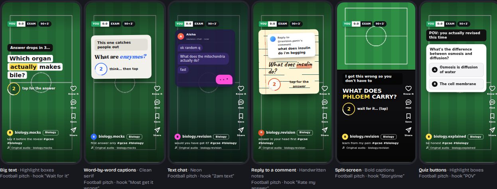
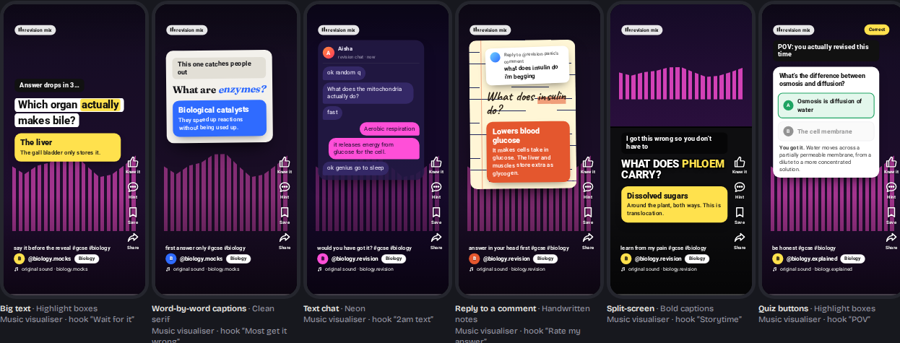
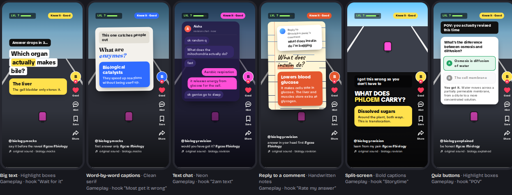

# Card design

**Goal: a card should pass as a reel at a glance.** If it looks like a quiz app interrupting TikTok,
students swipe it away before reading it. So every card is built from what's already on their screen:
the host app's frame, the formats creators use, and the things that student watches.

The design is implemented twice from the same spec: in the web demo
([`web-demo/src/render.js`](../web-demo/src/render.js) and the `.card` rules in
[`head.html`](../web-demo/src/head.html)) and in the Android app
([`CardView.java`](../app/src/main/java/com/reelcards/app/CardView.java)). The web demo's **design lab**
shows every layout for any app, interest, state and time of day side by side.

---

## 1. The host app's frame

Each app reserves different edges of the screen for its own buttons and captions. Cards keep their
text inside each app's **safe zone**, and draw that app's furniture in the same places, so the card
and the app's real overlay line up.

| App | Safe zone on 1080 × 1920 (top / bottom / left / right) | Rail | Caption band | Typeface |
|---|---|---|---|---|
| TikTok | 108 / 320 / 60 / 120 px | avatar with "+", ♥, comment, bookmark, share | @account, caption + 2 hashtags, ♫ original sound | [TikTok Sans](https://developers.tiktok.com/blog/tiktok-sans-open-source) (OFL) |
| Instagram Reels | 210 / 310 / 40 / 84 px | ♥, comment, bookmark, paper plane | avatar, account, outlined subject pill, caption, ♫ Original audio | system sans |
| YouTube Shorts | 120 / 300 / 48 / 96 px | 👍, comment, bookmark, share | title first, then avatar, @account, filled pill, sound | Roboto |

The safe-zone figures are consolidated from creator safe-zone guides
([1](https://postplanify.com/blog/social-media-safe-zones-2026-complete-guide),
[2](https://creamate.ai/en/blog/tiktok-safe-zone-guide),
[3](https://www.upload-post.com/tools/safe-zone-checker/)). They change when the apps redesign,
so they live in one function (`safeZone()` in both implementations).

The rail buttons do real things: ♥ = "knew it", the speech bubble gives a **hint** (first letter and
length), the bookmark **saves** the card (back within a day), and share sends the question to a
friend. Icons are generic outline shapes drawn for Reelcards, with no platform logos. A thin progress line
runs along the bottom (red on YouTube, white elsewhere), like a real reel.

## 2. Creator formats

**Looks:** text treatments borrowed from creator editing tools.

| Look | Treatment | Key word |
|---|---|---|
| Bold captions | heavy uppercase, black outline (reads on any footage) | yellow |
| Highlight boxes | each line on its own white rounded box (the "text background" style) | yellow box |
| Clean notes | serif headline on a paper-white notes page (Fraunces) | italic, blue |
| Neon | condensed uppercase with a glow (Anton) | pink |
| Handwritten notes | handwriting on ruled paper with a red margin (Caveat) | highlighter stroke |

The key word is the longest word of five or more letters, the word auto-captions would highlight.
Questions shrink to fit, and never break a word across lines.

**Light looks float as a notes "sheet"** (slightly rotated, with a shadow) over dark footage,
like a creator screenshotting their notes. That keeps the card reading as a reel, not a slide.

**Layouts:** big text · word-by-word captions (the question arrives in beats, about 3 words a second,
like auto-captions) · a group-chat screenshot (the answer arrives as the reply) · "replying to
@user's comment" · split-screen over gameplay · a two-option poll sticker · a numbered list (one
blank per point, for answers with several points).

**Hooks** sit in a pill at the top, the first thing read: "POV: …", "Wait for it…", "Most people
get this wrong", "text at 2am", "Rate my answer", "Storytime".

**Backgrounds** are drawn in code as stand-ins for looping footage (keeps the app tiny and
offline): a satisfying soap-cutting clip, an endless-runner track, a city walk at night, a football
pitch, a soft bokeh glow, a music visualiser. They're dimmed under the text, with a scrim at the top
and bottom so the app's own white UI stays readable.

## 3. Long answers and long questions

A reel is read in seconds, so a card is drawn by the *shape* of its answer, not just its words
([`AnswerShape.java`](../engine/src/main/java/com/reelcards/engine/AnswerShape.java), `analyse()` in
the web demo).

| Shape | Example | How it's drawn |
|---|---|---|
| Short (up to 48 characters) | "The liver" | one answer box, in any layout |
| One long sentence | "No atoms are lost or made…" | a smaller answer box; no quiz buttons |
| List, steps or a paragraph | "A; B; C" · "A → B → C" · "1. … 2. …" · one per line · "A, B, C and D" · 2+ sentences | 2–6 points, as below |

The idea is SuperMemo's [minimum information principle](https://www.supermemo.com/en/archives1990-2015/articles/20rules):
recall is more reliable for small items, so a long answer is reviewed as its parts, the way a mark
scheme splits a 3-mark answer into 3 points.

- **Before the reveal:** a "3 MARKS" pill under the question, the cue students know from exam papers
  for how much to recall. The **numbered list** layout goes further: one striped blank per point,
  sized to its answer ("3 marks. Can you get all 3?"). The hint fills each blank with its first word.
- **The reveal:** points drop in one after another, like a "3 things…" reel, timed to how long each
  takes to read. The question shrinks up to 60% and the hook goes, so the answer has the room. A tap
  shows the rest straight away.
- **Part marks:** tap the points you got. All of them = Good, at least half = Hard, fewer = Again
  (a hint still caps it at Hard). Double-tapping still means "got it all"; unticking a point after
  that turns it into part marks. The badge says "2/3 · Hard".
- **In the chat layout** the answer arrives as one message per point, the way people text. The small
  talk drops out so the question stays in view, and you react ✓ to the messages you got.
- **Explanations:** a short one sits under the answer. A long one goes in the caption behind
  "more", the way long captions work in every reel app; tapping it opens the caption over a dimmed
  card.
- **Long questions** (over 90 characters, 2+ sentences): the set-up goes in a small quoted box with
  an accent bar and the actual question stays big. In "reply to a comment", the comment carries the
  whole question.
- **Layouts follow the shape:** quiz buttons only for short answers (and only with short wrong
  answers); split-screen only where the answer fits a third of the screen; word-by-word captions only
  for questions up to 140 characters with no set-up; the numbered list only for 2+ points.
- **Timing scales with length:** the think ring counts 3 to 7 seconds by reading time, and the
  progress line runs 10 to 30 seconds.
- **Fit pass:** if anything would spill out of the safe zone, the text shrinks a step at a time (down
  to 60%) before the card is drawn, and a long chat scrolls its oldest messages away.

## 4. Cards from Anki files: pictures, cloze and image occlusion

Students who already use Anki can open an exported deck (.apkg) straight in the app
([`AnkiPackage.java`](../engine/src/main/java/com/reelcards/engine/anki/AnkiPackage.java), `Apkg` in the
web demo). Two Anki card types don't fit a "question, then answer" reel, so they get their own design.

**Cloze** ("{{c1::Mitochondria}} are the site of aerobic respiration"):
- One card per gap number, as in Anki. The gap is drawn as a blank in the look's style: an accent block
  for the bold looks, an underline on handwritten notes, italic on the clean serif, a glow on neon. If
  the deck gives a hint ("{{c1::…::type of respiration}}"), the hint sits inside the blank.
- No key word is highlighted, so nothing competes with the gap.
- One gap number used several times ("solid, liquid and gas" as three c1 gaps) becomes a
  multi-point answer, with part marks like any long answer.
- The whole sentence, with the gap filled in, goes behind "more" with any Back Extra.
- A gap stays in one beat in the word-by-word captions, and shows in the quiz layout's question and the numbered list.
  The voiceover and screen readers say "blank".

**Image occlusion** (a diagram with labels masked out):
- The picture leads. It's drawn as big as the safe zone allows: on dark looks it may run on under the
  rail's column as long as it ends above the rail; on notes sheets it stays inside the sheet. The
  question (the deck's header, or "Name the highlighted part") sits under it, smaller.
- The mask for this card is filled with the look's accent colour; the other masks are cream, as in
  Anki. Masks are stored as fractions of the picture, and the picture is sized from its own
  dimensions, so they line up at any size.
- **Tap:** the accent mask fades to an outline, uncovering the label under it. **Double-tap:** "knew
  it", as on every card. A pill under it says "Double-tap if you got it", then "Got it".
- **Hint:** the other labels uncover, so you can rule them out.
- Masks that Anki shows only on their own card (no "occlude inactive") aren't drawn on the others.

**Pictures on normal cards:** the front's picture sits under the question (the question shrinks to
70%), the back's under the answer. A card whose answer is only a picture shows just the picture.
Picture cards always use big text, the one layout with room for them.

## 5. Themed to the student

At setup students pick what they watch. Cards then pick up a small, recognisable touch, and the
format engine starts with a lean towards matching backgrounds and formats:

| Interest | Badge (top left) | Leans towards |
|---|---|---|
| Football | broadcast scorebug "YOU 0–0 EXAM · 90+3′" (the score updates when you get it right) | pitch, "POV" hook |
| Gaming | HUD "LVL 7" with an XP bar, "+25 XP" pops on a right answer | runner gameplay, split-screen, "Wait for it" |
| Music | "revision mix" pill with a visualiser | music visualiser, neon, captions |
| Fitness | "SET 1 · REP 1" → "PR ✓" | city walk, "POV", bold captions |
| Beauty | "✦ GRWM · revision edition" | soft glow, notes pages |
| Food | "let it cook · 0:03" | satisfying clip, handwritten notes |
| Comedy | "no laughing" | "text at 2am", reply-to-a-comment, group chat |

## 6. Time and colour

- **Night:** from 10pm to 6am the light looks switch to dark versions: the clean page becomes
  warm dark paper, the handwritten notes become a chalkboard. Students can force it on or off.
- **Match my feed's colours** (opt-in, Android 11+, off by default): dark looks are tinted to the
  dominant colour of the reel the student just watched. The app takes one screenshot after each reel
  settles, shrinks it to 24 × 48 pixels in memory, keeps a single hue and discards the image
  ([`FeedColour.java`](../app/src/main/java/com/reelcards/app/FeedColour.java)). It uses Android's
  [`AccessibilityService.takeScreenshot`](https://developer.android.com/reference/android/accessibilityservice/AccessibilityService).

## 7. States and first use

- **Question:** a countdown ring (3, 2, 1, ?) with the reveal prompt. Tap anywhere to reveal.
- **Hint:** a white chip under the question, a half-typed reply in the chat layout, or a note in the poll.
- **Answer:** an accent-coloured box that drops in, with a one-line explanation. Long answers drop in
  point by point instead, with a tick on each ("Tap the ones you got").
- **Part marks:** ticked points fill in with the accent colour and the badge shows "2/3 · Hard".
- **Caption opened:** the caption grows up the screen over a dimmed card; tap anywhere to close it.
- **Knew it:** the heart fills, a big heart bursts where you tapped, and a badge says how it was
  graded ("Knew it · Easy", "With a hint · Hard").
- **First two cards ever:** a coach tip, "Tap to see the answer · Double-tap if you knew it", fades
  out after 4 seconds.

## 8. Accessibility

- White text on footage always has an outline, a box or a scrim behind it.
- Touch targets: rail buttons 50 dp, the reveal button 56 dp, poll options 50 dp, the chat reply 44 dp,
  answer points 48 dp (at every fit step).
- Answer points read as checkboxes in TalkBack, and focus stays on a point after you tick it. The
  caption's "more" is a labelled action, so the explanation itself is still read out.
- Text respects the phone's font size, up to 130%, beyond which the reel layout would break.
- Background motion stops when "Remove animations" is on.
- Every control has a content description for TalkBack. The optional voiceover reads the hook and
  question aloud, like creators do.

---

## How the design was made, and how to iterate

1. **Reference:** creator safe-zone guides, the apps' own layouts, creator formats, and TikTok's
   open-source typeface.
2. **Build in the browser first.** The design lab in the web demo renders every layout for every app,
   interest, state and night mode at once, which makes inconsistencies easy to spot.
3. **Screenshot and critique.** Screens were rendered headless with Playwright and reviewed with a
   structured design critique (first impression, usability, hierarchy, consistency, accessibility).
   Round one found the light looks read as slides, the hint covered the question, the hook was too
   small and the gameplay stand-in looked like a placeholder. All were fixed in round two
   ([critique notes](design-critique.md)).
4. **Port to Android** and review the port for behaviour differences.

To change the design: edit `web-demo/src/head.html` and `render.js`, run
`python3 tools/build-web-demo.py`, check the design lab, then mirror the change in `CardView.java`.
The most valuable next input is **screenshots from real students' feeds** (and real phones running the
APK), to compare against.

## Fonts

All bundled under the SIL Open Font License, with licence files in
[`app/src/main/assets/fonts`](../app/src/main/assets/fonts): TikTok Sans
([announcement](https://developers.tiktok.com/blog/tiktok-sans-open-source)), Anton, Fraunces and Caveat.
They're cut down to Latin characters and the weights the cards use (about 430 KB in total).

The app's own screens (setup, dashboard, the extension popup and the web demo's app) use **Inter**
(OFL, three weights cut to Latin, about 240 KB). They're quiet and light by day and dark when the
phone or browser is: off-white or near-black ground, ink pill buttons, and headings as a black line
over a grey one. The tokens are the same in `Ui.java`, `.app` in `head.html` and `popup.html`. The
welcome screen and dashboard have a moving hero (`MotionView.java`, `motion()` and `sea()` in
`app.js`): a navy sea of short dashes drifting on a slow current, a small orange swimmer they turn
towards, and waves of white foam rolling past (the feed washing over you). A wheel of topics rolls
along a curve over it, the middle one bracketed with a grey note ("[ Enzymes ] 9 due"). On the dashboard the wheel shows your decks and today's numbers. It
stops when the phone's animations are off (reduce motion). Cards keep their host-matched faces so
they still pass as reels. The widget uses the system font: launchers draw it, and custom fonts there
need Android 12+.

The sea is the welcome screen's whole background, fading to solid navy under the words at the bottom. On the dashboard it's the top of the page, melting into it and scrolling away with the content. Foam is kept soft behind the wheel so the words stay readable.

Behind the dashes is a slow shapeshifting colour field (`PAL` and `field()` in `app.js`, mirrored in `MotionView.java`): a deep base with three soft blobs of colour drifting over it, easing every 30 seconds into the next palette (ocean, dusk, lagoon, indigo). It starts on a palette that follows the hour, so the colours change as time goes on, like Reelcards itself changing shape from card to card. The palettes stay dark enough that the white dashes and words always read, and the swimmer's orange stays clear of every one.

In light mode the colour field is airy and white (sky, blush, mint and periwinkle, with soft cyan and bright blue drifting through), with dark navy ink for the dashes, the wheel and the words; the foam is a darker blue band. Dark mode keeps the deep palettes with white ink. Both follow the phone's setting.
